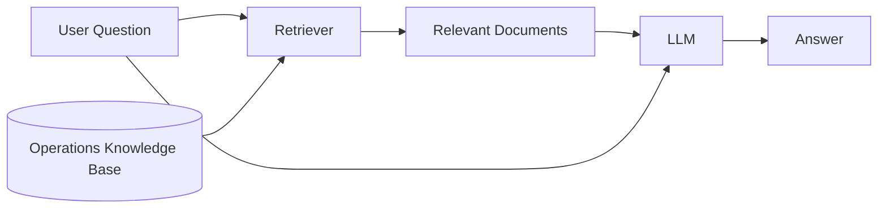

# Module 7 – Lab 1: Build a Simple RAG Application using LangChain

**Module:** 7 – Basic LLM Systems (RAG)
**Scenario:** IT Operations Knowledge Assistant
**Main artifact:** `module7_lab1_simple_rag.ipynb`

You will build a small Retrieval-Augmented Generation (RAG) application. An operations engineer asks a question, the application finds the relevant records in an IT Operations knowledge base, and an LLM writes an answer **using only those records**. If the knowledge base does not contain the answer, the assistant says so.

---

## 1. Learning objectives

By the end of the lab you can:

1. Load a CSV or PDF knowledge base with LangChain loaders (`CSVLoader`, `PyPDFLoader`).
2. Split documents into chunks with `RecursiveCharacterTextSplitter`.
3. Generate embeddings with `OpenAIEmbeddings`.
4. Store embeddings in a local FAISS vector store and retrieve the most relevant chunks.
5. Build and run a simple LCEL RAG chain that answers from the retrieved context.

---

## 2. Prerequisites

- Windows with **Python already installed** (the lab uses that interpreter).
- **VS Code** with the Python extension and the Jupyter extension.
- An **OpenAI API key** (your facilitator will tell you whether to create one or use one provided for the session).
- Basic Python knowledge (variables, functions, lists) and a general idea of what an LLM is.

---

## 3. Technologies used

| Technology | Purpose |
|---|---|
| LangChain (`langchain==1.3.14`) | Framework for the RAG pipeline |
| `langchain-community` | `CSVLoader`, `PyPDFLoader`, `FAISS` |
| `langchain-text-splitters` | `RecursiveCharacterTextSplitter` |
| `langchain-openai` | `OpenAIEmbeddings`, `ChatOpenAI` |
| `langchain-core` | Prompts, output parser, runnables (LCEL) |
| FAISS (`faiss-cpu`) | Local, in-memory vector store |
| `pypdf` | Reads text from PDF files |
| `python-dotenv` | Loads `OPENAI_API_KEY` from `.env` |
| OpenAI models | `text-embedding-3-small` (embeddings), `gpt-4o-mini` (answers) |

### Detected versions (training workstation)

| Item | Version |
|---|---|
| Python (active interpreter, `python --version`) | 3.10.11 |
| langchain | 1.3.14 |
| langchain-core | 1.5.3 |
| langchain-community | 0.4.2 |
| langchain-openai | 1.4.2 |
| langchain-text-splitters | 1.1.2 |
| faiss-cpu | 1.14.3 |
| pypdf | 6.14.2 |
| python-dotenv | 1.0.1 |

**Version source.** The LangChain version is the one used in the previous Module 7 Lab 1 (`langchain==1.3.14`). That lab replaced the deprecated `RetrievalQA` class with the LCEL chain pattern, which this lab also uses. No newer LangChain release was installed. The packages were already installed in the interpreter, so no installation was needed.

---

## 4. Simple RAG architecture



The five stages:

1. **Document Loading**: read the CSV or PDF into `Document` objects.
2. **Text Splitting**: cut documents into chunks.
3. **Embedding Generation**: turn each chunk into a vector of numbers that represents its meaning.
4. **Document Retrieval**: find the chunks whose vectors are closest to the question's vector.
5. **Response Generation**: give the retrieved chunks and the question to the LLM, which writes the answer.

---

## 5. Project structure

```text
Module7_Lab1_Simple_RAG/
│
├── module7_lab1_simple_rag.ipynb   # the hands-on notebook (start here)
├── operations_knowledge_base.csv   # default knowledge base: 29 IT operations records
├── requirements.txt                # packages for this lab
├── README.md                       # this file
├── .env.example                    # template for your API key
└── .gitignore                      # keeps .env and notebook checkpoints out of git
```

The knowledge base covers server CPU, memory, disk and storage, availability, application restarts, database and network connectivity, DNS, firewall, backups, monitoring, incidents, security, patching, disaster recovery and maintenance.

---

## 6. Existing Python environment

This lab uses the **Python interpreter already installed** on your computer. Do **not** create a new virtual environment, do not run `python -m venv`, and do not install another Python version or Anaconda.

Check which interpreter you are using. Open a PowerShell window in the `Module7_Lab1_Simple_RAG` folder and run:

```powershell
python --version
python -m pip --version
```

The notebook must run on the **same** interpreter where the packages are installed. Both commands above should point to the same Python installation (for example `Python310`).

---

## 7. Dependency installation

From the `Module7_Lab1_Simple_RAG` folder, install the packages into the existing interpreter:

```powershell
python -m pip install -r requirements.txt
```

Optional check that the installed packages are consistent:

```powershell
python -m pip check
```

Notes:

- `requirements.txt` pins the LangChain packages to the versions listed in section 3. Running the install again does not upgrade them.
- If every package is already installed, pip reports "Requirement already satisfied" and changes nothing. That is expected.
- Do not run `pip install --upgrade` on the LangChain packages.

---

## 8. API-key configuration

1. In the `Module7_Lab1_Simple_RAG` folder, copy `.env.example` and name the copy `.env`.
   - PowerShell: `Copy-Item .env.example .env`
   - File Explorer: copy the file and rename the copy to `.env`.
2. Open `.env` in Notepad and replace the placeholder with your key, on the same line:

   ```text
   OPENAI_API_KEY=sk-...your key...
   ```

3. Save the file. Do not add quotes, spaces or a second line for the key.

**Security rules for this lab**

- Never paste the key into the notebook, the README or any screenshot.
- Never commit `.env` to git. `.gitignore` already excludes it.
- The notebook reads the key with `python-dotenv` and never prints it.

---

## 9. How to open the notebook in VS Code

1. In VS Code, choose **File → Open Folder** and select the `Module7_Lab1_Simple_RAG` folder.
2. Open `module7_lab1_simple_rag.ipynb`.
3. Select the interpreter: press **Ctrl+Shift+P**, run **Python: Select Interpreter**, and choose the Python installation you checked in section 6 (3.10.11 on the training workstation).
4. Select the kernel: click **Select Kernel** at the top right of the notebook and choose that same Python.

---

## 10. How to execute the notebook cells sequentially

- Run cells **from top to bottom**. Each section depends on the variables created above it.
- Run one cell at a time with **Shift+Enter**, or run everything with **Run All**.
- If something looks wrong, choose **Restart** and then **Run All** to start from a clean state.
- The notebook is about 32 cells: 20 code cells and 12 Markdown cells.

**What to expect**

- Section 2 stops with a clear message if `.env` or `OPENAI_API_KEY` is missing.
- A `DeprecationWarning` about `langchain-community` appears on the import cell. It is harmless (see troubleshooting).
- Each **Run All** calls the OpenAI API to create embeddings for every chunk and to answer questions. This costs a small amount each time, so avoid unnecessary full re-runs.

---

## 11. How to change the knowledge-base file

The knowledge base is set in the **configuration cell** in Section 2:

```python
KB_PATH = "operations_knowledge_base.csv"   # knowledge base file: .csv (default) or .pdf
```

To use a different CSV with the same column layout, change the file name, or edit the default file. Restart the notebook and run all cells again.

---

## 12. How to switch between the supplied CSV and your own PDF

The notebook chooses the loader from the file extension:

| File extension | Loader used | What one document is |
|---|---|---|
| `.csv` (default) | `CSVLoader` | one row (one record) |
| `.pdf` (optional) | `PyPDFLoader` | one page |

To use your own PDF:

1. Copy the PDF into the `Module7_Lab1_Simple_RAG` folder (for example `my_ops_manual.pdf`).
2. In the configuration cell, change the line to:

   ```python
   KB_PATH = "my_ops_manual.pdf"
   ```

3. Restart the notebook and run all cells again.
4. Ask questions that your PDF can answer. The five questions in Section 8 are written for the default CSV, so some will not be answered by a different document. That is the expected behaviour.

To go back to the CSV, set `KB_PATH = "operations_knowledge_base.csv"`.

**PDF limits**

- `PyPDFLoader` reads text only. A scanned PDF (an image of a page) has no text, so the notebook stops in Section 4 with the message "No text was found in the knowledge base". Use a text-based PDF.
- Large PDFs create many chunks, which makes each run slower and use more API calls.

**Other settings you can change** (configuration cell): `CHAT_MODEL`, `EMBEDDING_MODEL`, `CHUNK_SIZE`, `CHUNK_OVERLAP` and `TOP_K`.

---

## 13. Explanation of the five RAG stages

| Stage | Notebook section | Plain-English summary |
|---|---|---|
| 1. Document Loading | Section 3 | The loader turns each CSV row (or PDF page) into a `Document` with text and metadata. |
| 2. Text Splitting | Section 4 | Long documents are cut into chunks of about `CHUNK_SIZE` characters, with `CHUNK_OVERLAP` characters shared between neighbours. |
| 3. Embedding Generation | Section 5 | Each chunk becomes a list of 1,536 numbers that represents its meaning. Similar meanings give similar numbers. |
| 4. Document Retrieval | Section 6 | The question is embedded the same way, and FAISS returns the `TOP_K` chunks closest to it. |
| 5. Response Generation | Section 7 | The chain puts the retrieved chunks and the question into a prompt. The LLM answers using only that context. |

The question flow is: **question → embedding → similarity search → top-k chunks → prompt → LLM → answer**. Section 9 traces one question through each stage.

---

## 14. Hands-on exercises

The full instructions are in Section 10 of the notebook.

1. **Add three new records.** Add rows OPS-030 to OPS-032 to the CSV, re-run from Section 3, and check that the document count rises by three.
2. **Change the chunk size.** Try `CHUNK_SIZE` of 300, 500 and 1000 with `CHUNK_OVERLAP = 100`. Compare the chunk counts (about 122, 71, 34 and 29 in our test run) and explain why smaller chunks produce more of them.
3. **Change top-k.** Set `TOP_K = 5`, rebuild the chain and compare the retrieved chunks with `TOP_K = 3`.
4. **Make answers more concise.** Edit the prompt, for example to ask for at most three short bullet points. Keep the exact "not found" sentence.
5. **Ask an unanswerable question.** Ask about something the knowledge base does not cover, such as onboarding a new employee. Check that the assistant says the answer could not be found.

The notebook ends with a five-question multiple-choice quiz. The instructor answer key is in the last Markdown cell.

---

## 15. Expected results from the verified run

- Documents loaded from the CSV: **29** (one per record, OPS-001 to OPS-029).
- Chunks with the default settings (`CHUNK_SIZE = 800`, `CHUNK_OVERLAP = 100`): **34**. Five longer records are split.
- Embedding dimensions: **1536**.
- For the question about CPU above 90%, the answer follows the steps in record OPS-001.
- For a question not covered by the knowledge base (replacing a UPS battery), the answer is: *The answer could not be found in the available Operations Knowledge Base.*

Your wording may differ slightly from run to run, but the facts should match the record cited in the answer.

---

## 16. Troubleshooting

| Symptom | Likely cause | What to do |
|---|---|---|
| `python` is not recognised | Python is not on the PATH | Ask your facilitator to check this computer. Do not install another Python. |
| `ModuleNotFoundError: No module named 'langchain_...'` (or `faiss`, `pypdf`, `dotenv`) | Packages were installed into a different interpreter than the notebook kernel | Check the interpreter in section 9, then run `python -m pip install -r requirements.txt` in that same interpreter. |
| Notebook stops with `OPENAI_API_KEY not found` | `.env` is missing, misnamed or empty | Make sure the file is named exactly `.env`. In File Explorer, enable **File name extensions** so it is not `.env.txt`. Check the line in section 8. |
| `401` or `Incorrect API key` | The key was copied wrongly or is no longer valid | Copy the key again with no extra spaces. If it still fails, ask your facilitator. |
| `404` or `model does not exist` | A model name is not available to your account | Set `CHAT_MODEL` or `EMBEDDING_MODEL` in the configuration cell to a model your facilitator confirms. |
| `429` or quota or rate-limit error | Too many requests or no remaining credit | Wait a minute and run again, or ask your facilitator. Avoid repeated full runs. |
| `DeprecationWarning: langchain-community is being sunset` | Normal warning from this LangChain version | It can be ignored. `langchain-community` provides `CSVLoader`, `PyPDFLoader` and `FAISS` for this version. |
| No kernel or the kernel does not start | VS Code has no Python selected | Repeat section 9. `ipykernel` is listed in `requirements.txt`. |
| `UnicodeDecodeError` when loading the CSV | The file is not UTF-8 | In Excel, save as **CSV UTF-8 (Comma delimited)**. The loader also accepts a BOM. |
| `No text was found in the knowledge base` | The PDF is scanned or has no selectable text | Use a text-based PDF. Scanned pages need OCR first, which is outside this lab. |
| `Knowledge base file '...' was not found` | `KB_PATH` does not match the file name, or the file is in a different folder | Check `KB_PATH` in the configuration cell and put the file in the lab folder. |
| `Unsupported file type '...'` | `KB_PATH` ends in something other than `.csv` or `.pdf` | Use a `.csv` or `.pdf` file. |
| Answers look generic or wrong | Retrieval is returning the wrong chunks | Look at the retrieved chunks in Section 6 and Section 9. Try a different `CHUNK_SIZE` or `TOP_K`. |
| Results differ from a colleague's | The cells were run out of order, or settings differ | Choose **Restart**, then **Run All**. Check that the settings match. |
| `faiss` import error on install | No wheel for this Python version | Tell your facilitator the Python version. Do not change the Python installation yourself. |

---

## Notes for facilitators

- The notebook was saved after a complete run, so its outputs show the expected results. Participants' outputs will vary slightly.
- The knowledge base is fictional sample content for teaching. It is not a real operations runbook.
- The LangChain versions in `requirements.txt` were chosen to match the previous Module 7 Lab 1. Do not upgrade them during the lab.
