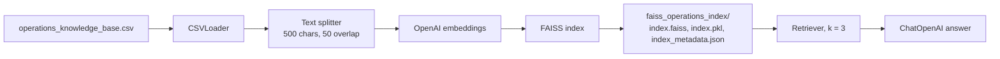

# Module 7 Lab 2: Build a Vector Store and Retriever with LangChain and FAISS

## 1. Lab overview

This lab continues **Module 7 Lab 1 (Simple RAG)**. You build a FAISS vector store from the IT Operations knowledge base, save it to disk, reload it without generating document embeddings again, and use a LangChain retriever to answer operations questions with an LLM.

Everything is in one notebook: `module7_lab2_vector_store_retriever.ipynb`.

## 2. Learning objectives

1. Explain the role of a vector database in RAG.
2. Generate embeddings from operations records.
3. Create a local FAISS vector store that keeps metadata.
4. Persist the FAISS index to a local folder.
5. Reload a saved index and check whether it still matches the source data.
6. Create a LangChain retriever and run similarity searches.
7. Use retrieved records to answer IT Operations questions with an LLM.

## 3. Prerequisites

- Module 7 Lab 1 completed (this lab reuses its dataset and LangChain versions).
- Python already installed. This lab was prepared with **Python 3.10.11**.
- VS Code with the Python and Jupyter extensions.
- An OpenAI API key with available credit.

## 4. Technology stack

| Component | Version | Purpose |
|---|---|---|
| Python | 3.10.11 | Runtime (the interpreter already installed) |
| langchain | 1.3.14 | Framework (same version as Lab 1) |
| langchain-core | 1.5.3 | Prompts, runnables and core interfaces |
| langchain-community | 0.4.2 | `CSVLoader` and the `FAISS` integration |
| langchain-openai | 1.4.2 | `OpenAIEmbeddings` and `ChatOpenAI` |
| langchain-text-splitters | 1.1.2 | `RecursiveCharacterTextSplitter` |
| faiss-cpu | 1.14.3 (requirement `>=1.7.0`) | Local vector index |
| python-dotenv | 1.0.1 | Reads the API key from `.env` |
| ipykernel | 7.3.0 | Runs the notebook in VS Code |
| OpenAI models | `text-embedding-3-small`, `gpt-4o-mini` | Embeddings and answers |

## 5. Vector store architecture



The index folder is created by the notebook. It stores the vectors, the text and metadata of each chunk, and a small `index_metadata.json` with the source checksum. On each run the notebook compares that checksum with the current CSV. If nothing has changed, the saved index is reused and no document embeddings are generated.

## 6. Project structure

```text
Module7_Lab2_Vector_Store_Retriever/
├── module7_lab2_vector_store_retriever.ipynb
├── operations_knowledge_base.csv
├── requirements.txt
├── README.md
├── .env.example
└── .gitignore
```

`faiss_operations_index/` and `.env` are created on your machine. They are not part of the project files.

## 7. Existing Python environment

- Use the Python interpreter that is already configured in VS Code.
- Do **not** create a virtual environment or a Conda environment, install Anaconda, install another Python version, or change the default interpreter.
- The notebook must run on the **same interpreter** where the packages are installed. In the notebook, use the kernel picker at the top right and choose that interpreter.

## 8. Dependency installation

Run these commands in the VS Code terminal, from the project folder:

```bash
python --version
python -m pip --version
python -m pip install -r requirements.txt
```

The command installs only the packages in `requirements.txt` and keeps the LangChain versions used in Lab 1. It does not upgrade other packages. `pypdf` is not needed because this lab uses the CSV file only.

## 9. API-key configuration

1. Copy `.env.example` to a new file named `.env` in the project folder.
2. Replace `your_openai_api_key_here` with your OpenAI API key.
3. Never share or commit `.env`. The `.gitignore` file excludes it.

The notebook checks that the key is available and never prints it.

## 10. How to open the notebook in VS Code

1. Open the project folder in VS Code (**File > Open Folder**).
2. Open `module7_lab2_vector_store_retriever.ipynb`.
3. Select the kernel: the existing Python interpreter where the packages were installed.

## 11. How to execute the cells sequentially

- Run the cells **from top to bottom** (Run All, or Shift+Enter on each cell).
- Do not skip cells. Later cells use variables created by earlier cells.
- After restarting the kernel, run the notebook from the top again.

## 12. How to create the FAISS index

On the first run there is no saved index. Section 6 sends every chunk to the embedding model and builds the index. With the default settings the CSV becomes **71 chunks**, and all 71 are embedded.

## 13. How to persist the index

Section 7 saves the index to `faiss_operations_index/`. The folder is generated automatically when the notebook runs. It stays on your machine and should not be shared with untrusted people:

| File | Purpose |
|---|---|
| `index.faiss` | The vector index, used for fast similarity search |
| `index.pkl` | The document store: each chunk's text and metadata |
| `index_metadata.json` | The source checksum, embedding model, chunk settings, chunk count and build time |

## 14. How to reload the index

Restart the kernel and run the notebook from the top. Section 6 reports the state **`current`** and prints `Reusing the saved index. No document embeddings will be generated.` Each question still needs one embedding call.

> **Security:** `index.pkl` is a Python pickle file, and loading a pickle can run code. The notebook uses `allow_dangerous_deserialization=True` only for the index it created. Load only index folders you created yourself or received from a trusted source. Never download an index from an unknown source, and do not share your index folder with untrusted people.

## 15. How to use the retriever

Section 10 turns the vector store into a retriever:

```python
retriever = vector_store.as_retriever(search_kwargs={"k": 3})
```

`k` (also `TOP_K` in the configuration cell) is the number of records returned per question. Change it to compare results.

## 16. How to rebuild after dataset changes

- **Automatic:** if you change the CSV (add, edit or remove records), the next run reports `changed` and rebuilds the index.
- **Automatic:** if you change `CHUNK_SIZE`, `CHUNK_OVERLAP` or `EMBEDDING_MODEL`, the index is rebuilt.
- **Manual:** set `REBUILD_INDEX = True` in the configuration cell to force a rebuild.
- Restarting the notebook alone does **not** trigger a rebuild.

## 17. Hands-on exercises

The full instructions are in Section 14 of the notebook.

1. **Create a vector store:** delete `faiss_operations_index/`, run the notebook and note the number of chunks embedded.
2. **Persist the index:** open `faiss_operations_index/` and read `index_metadata.json`.
3. **Reload the index:** restart the kernel, run from the top, and confirm the state is `current`.
4. **Change top-k:** change `TOP_K` from 3 to 5, re-run from Section 10, and compare the results.
5. **Rebuild after changes:** add two records to the CSV, run again, confirm the state is `changed`, and check the new records are retrieved.

The notebook also includes five quiz questions (the answers are in the instructor section at the end).

## 18. Troubleshooting

| Problem | What to check |
|---|---|
| `OPENAI_API_KEY not found` | The file must be named `.env` (not `.env.txt`) and sit in the project folder. Restart the kernel after editing it. |
| `ModuleNotFoundError` for LangChain or FAISS | The kernel is using a different interpreter. Select the interpreter where `requirements.txt` was installed. |
| `FileNotFoundError: operations_knowledge_base.csv` | Open the notebook from the project folder so the CSV is found. |
| The index is rebuilt on every run | Check that `REBUILD_INDEX` is `False`, that `index_metadata.json` exists, and that the CSV and chunk settings have not changed. |
| State is `changed` after you did not edit the CSV | Re-saving the file in Excel can change line endings or encoding. A rebuild is then expected. |
| Error while loading the saved index (for example a corrupted file or a pickle error) | Delete the `faiss_operations_index/` folder and run the notebook again. It rebuilds the index from the CSV. |
| `DeprecationWarning` about `langchain-community` | Expected with the pinned version. It does not stop the notebook. |
| Authentication, quota or rate-limit errors from OpenAI | Check the key, billing and usage limits in your OpenAI account. |
| Diagram does not render | The text description in each section gives the same flow. |

## Version record

Versions detected in the training interpreter when this lab was prepared:

- Python **3.10.11**
- langchain 1.3.14, langchain-core 1.5.3, langchain-community 0.4.2, langchain-openai 1.4.2, langchain-text-splitters 1.1.2
- faiss-cpu 1.14.3, python-dotenv 1.0.1, ipykernel 7.3.0

These LangChain versions are the same as Module 7 Lab 1 (`requirements.txt`). No new Python environment was created.
