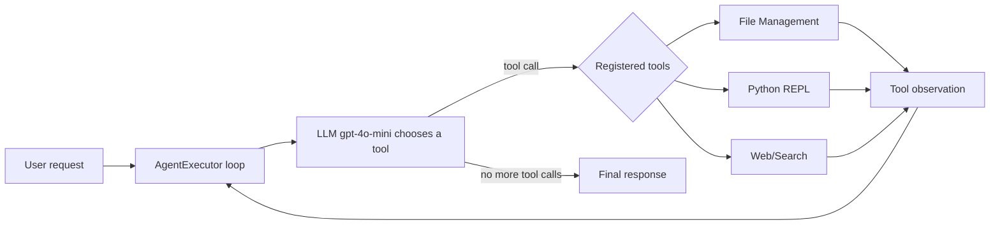

# Module 8 - Lab 1: Build an Agentic IT Operations Assistant with LangChain Built-in Tools

**Module:** 8 - Advanced LLM Systems &nbsp;|&nbsp; **Scenario:** IT Infrastructure Operations &nbsp;|&nbsp; **Main artifact:** `module8_lab1_agentic_operations.ipynb`

---

## 1. Lab overview

You build an **AI agent** that receives an operations request in plain English, decides which tools to use, runs them, reads what they return, and writes a response based on those results.

The agent uses three LangChain built-in tool categories:

| Tool category | Purpose in this lab |
|---|---|
| File Management | List, search and read files in `operations_workspace/`. Write new report files there. |
| Python REPL | Run small calculations on the data (averages, maxima, counts, capacity). |
| Web/Search | Look up generic public technical guidance (DuckDuckGo, no API key). |

The lab covers four IT Operations use cases: log analysis, capacity planning, incident investigation and operational reporting.

## 2. Learning objectives

By the end of the lab you can:

1. Explain what an AI agent is and how it differs from a normal LLM application.
2. Explain how a LangChain agent selects, executes and observes tools.
3. Use the File Management, Python REPL and Web/Search tools.
4. Read the verbose trace to see which tool the agent chose and why.
5. Run four operations use cases that combine several tools.
6. Recognise basic tool errors and agent limitations.

## 3. Prerequisites

- Windows with **Python already installed**. The lab uses that interpreter.
- **VS Code** with the Python and Jupyter extensions.
- **Module 7 Lab 1 and Lab 2 completed.** This lab reuses the same LangChain versions.
- An **OpenAI API key** with available credit. Sections 7 to 10 need it. Sections 1 to 6 do not.
- Internet access, for the OpenAI API and DuckDuckGo search.

## 4. Technologies used

| Technology | Version (detected) | Purpose |
|---|---|---|
| Python | 3.10.11 | Interpreter already installed on the workstation |
| `langchain` | 1.3.14 | LangChain framework (same as Module 7) |
| `langchain-core` | 1.5.3 | Prompts, tools, runnables (same as Module 7) |
| `langchain-community` | 0.4.2 | `FileManagementToolkit`, `DuckDuckGoSearchRun` (same as Module 7) |
| `langchain-openai` | 1.4.2 | `ChatOpenAI` (same as Module 7) |
| `langchain-classic` | 1.0.8 | `create_tool_calling_agent`, `AgentExecutor` (new in this lab) |
| `langchain-experimental` | 0.4.2 | `PythonREPLTool` (new in this lab) |
| `ddgs` | 9.14.4 | DuckDuckGo search backend, no API key (new in this lab) |
| `httpx` | 0.28.1 | HTTP client required by `ddgs` (installed with it) |
| `python-dotenv` | 1.2.4 | Reads `OPENAI_API_KEY` from `.env` (any version 1.0.0 or newer works) |
| `ipykernel` | 7.x | Runs the notebook in VS Code |
| OpenAI model | `gpt-4o-mini` | Chat model that drives the agent (same as Module 7) |

**Version source.** The LangChain versions were taken from the Module 7 Lab 1 and Lab 2 `requirements.txt` files and checked against the installed packages. No LangChain package was upgraded. The only other change was `httpx`, a dependency of `ddgs` (see section 8).

**Why three packages are new.** In LangChain 1.x, the agent API (`create_tool_calling_agent`, `AgentExecutor`) moved to `langchain-classic`. `PythonREPLTool` moved to `langchain-experimental`. DuckDuckGo search uses `ddgs`. All three are already installed in the training interpreter, and they are pinned in `requirements.txt`.

## 5. Agent architecture



- The **LLM** reads the request and the tool descriptions. It chooses a tool, or decides it can answer.
- The **AgentExecutor** runs the tool, sends the observation back to the LLM, and repeats. It stops at a final answer or at `MAX_ITERATIONS` (8).
- `verbose=True` prints every `Invoking:` line, so you can see the agent's choices.
- Tool errors are returned to the LLM as text, so the agent can recover instead of the notebook stopping.

**Why not `create_agent`?** The newer `langchain.agents.create_agent` API is built on LangGraph. The lab keeps to the simpler `create_tool_calling_agent` and `AgentExecutor` pattern.

## 6. Project structure

```text
Module8_Lab1_Agentic_Operations/
│
├── module8_lab1_agentic_operations.ipynb   # the hands-on notebook (start here)
├── operations_workspace/
│   ├── application.log                     # 32 application log lines (orders-api, 19 Nov 2026)
│   ├── server_metrics.csv                  # 12 server metric rows (6 servers, 2 snapshots)
│   └── incident_notes.txt                  # incident INC-20261119-001 notes
├── requirements.txt                        # packages for this lab (pinned)
├── README.md                               # this file
├── .env.example                            # template for your API key
└── .gitignore                              # keeps .env and generated files out of git
```

Files the notebook creates while it runs (not part of the ZIP): `operations_workspace/lab_test_report.txt` and `operations_workspace/daily_operations_report.txt`.

## 7. Existing Python environment

This lab uses the **Python interpreter already installed** on your computer. Do **not** create a new virtual environment, do not run `python -m venv`, and do not install another Python version or Anaconda.

Open PowerShell in the `Module8_Lab1_Agentic_Operations` folder and check:

```powershell
python --version
python -m pip --version
```

Both commands must point to the **same** Python installation (Python 3.10.11 on the training workstation). The notebook must use this same interpreter, because that is where the packages are installed.

## 8. Dependency installation

From the `Module8_Lab1_Agentic_Operations` folder:

```powershell
python -m pip install -r requirements.txt
python -m pip check
```

Notes:

- The packages are pinned. Running the install again does not upgrade them. If they are already installed, pip reports "Requirement already satisfied", which is expected.
- Do **not** run `pip install --upgrade` on any LangChain package.
- On a machine where `ddgs` was installed earlier with an older `httpx` (0.27.x), this install upgrades `httpx` to 0.28.1, because `ddgs` requires it. That is the only expected change.

## 9. API-key configuration

1. In the `Module8_Lab1_Agentic_Operations` folder, copy `.env.example` and name the copy `.env`.
   - PowerShell: `Copy-Item .env.example .env`
2. Open `.env` in Notepad and replace the placeholder on the same line:

   ```text
   OPENAI_API_KEY=sk-...your key...
   ```

3. Save the file. Do not add quotes, spaces or a second line.

**Security rules**

- Never paste the key into the notebook, this README or a screenshot.
- Never commit `.env` to git. `.gitignore` already excludes it.
- The notebook checks that a key exists, but it never prints the key.

## 10. How to open the notebook in VS Code

1. In VS Code, choose **File > Open Folder** and select the `Module8_Lab1_Agentic_Operations` folder. Opening the lab folder matters, because the notebook finds `operations_workspace/` relative to its folder.
2. Open `module8_lab1_agentic_operations.ipynb`.
3. Select the interpreter: press **Ctrl+Shift+P**, run **Python: Select Interpreter**, and choose the same Python 3.10.11 installation you checked in section 7.
4. At the top right of the notebook, click **Select Kernel** and choose that same Python.

## 11. How to execute the notebook cells sequentially

- Run the cells **from top to bottom**. Each section uses variables created above it.
- Run one cell at a time with **Shift+Enter**, or choose **Run All**.
- If something looks wrong, choose **Restart** and then **Run All**.
- Sections 1 to 6 work without a key. Sections 7 to 10 call the OpenAI API. Each agent request costs a small amount of credit, so avoid unnecessary repeats.
- The notebook has 32 cells: 19 code cells and 13 Markdown cells.

## 12. File Management tools

The lab uses LangChain's `FileManagementToolkit` with a restricted root folder (`operations_workspace/`).

| Tool | Purpose | Registered? |
|---|---|---|
| `list_directory` | Lists files in a folder inside the workspace | Yes |
| `read_file` | Reads one file, such as `application.log` | Yes |
| `file_search` | Finds files by name pattern, such as `*.log`. It searches file **names**, not the text inside files | Yes |
| `write_file` | Creates a new report file (`.txt` or `.md`) in the workspace. Wrapped by `SafeWriteFileTool` | Yes, with guards |
| `copy_file`, `move_file`, `file_delete` | Copy, move or delete files | **No** |

`SafeWriteFileTool` refuses to overwrite `application.log`, `server_metrics.csv` and `incident_notes.txt`, in any letter case and through `..` paths. It accepts only `.txt` or `.md` names. Paths outside the workspace, such as `../secret.txt`, are rejected by the toolkit for every file tool.

## 13. Python REPL

`PythonREPLTool` executes Python code that the agent writes, and returns the printed output as the observation. The LLM does not do arithmetic itself, so the results come from the program.

The tool is powerful and therefore restricted in this lab:

- Only a short list of safe built-in functions is available (`print`, `sum`, `max`, `min`, `round`, `len`, `sorted`, `map`, `filter`, `any`, `all` and similar).
- Before the code runs, it is checked. Code with `import` statements, or with names that start with double underscores (`__class__`, `__import__`), is rejected. Those are the usual ways out of a restricted namespace.
- `open`, `exec`, `eval` and operating-system access are unavailable. The REPL cannot read the workspace. The agent reads files with File Management, then passes the values into the code it writes.
- Code that runs for more than 5 seconds is stopped, so an endless loop cannot hang the notebook.

This is a **teaching guardrail, not a security sandbox**. Memory use is not capped, and a determined person may still find a way around these checks. In production, run untrusted code in an isolated container or service with no file or network access.

## 14. Web/Search

`DuckDuckGoSearchRun` sends a query to DuckDuckGo and returns snippets and links as text. It needs no API key.

- Use it only for **generic public** questions, such as "common causes of high server CPU utilization".
- **Never** send log lines, hostnames, IP addresses, incident IDs or other internal data.
- Treat results as **external reference material**, not as verified facts about your systems.

## 15. How the agent selects tools

The agent does not follow a fixed script. For each request:

1. The LLM reads the request and the **tool names and descriptions**.
2. It decides whether a tool is needed, and which one.
3. The tool runs, and its output is returned as an observation.
4. The LLM decides the next step: call another tool, or give the final answer.

Good tool descriptions lead to good tool choices. The verbose trace shows each choice as an `Invoking:` line. The request does not name the tool, so the choice is the agent's.

## 16. The four IT Operations use cases

Sample thresholds used in this lab are **training values, not production policies**:

- CPU above 85%: high. Memory above 85%: high. Disk above 90%: critical. Network latency above 100 ms: elevated.

| Use case | Expected workflow | Tools |
|---|---|---|
| 1. Log analysis | Read `application.log`, identify errors, count critical errors, summarise | File Management, Python REPL |
| 2. Capacity planning | Read `server_metrics.csv`, calculate, compare with thresholds, rank servers, recommend | File Management, Python REPL |
| 3. Incident investigation | Read `incident_notes.txt` and `application.log`, correlate timestamps, separate evidence from assumptions, suggest steps | File Management, optional Web/Search |
| 4. Operational reporting | Read logs and metrics, calculate, summarise risks, save `daily_operations_report.txt` | File Management, Python REPL, File Management (write) |

## 17. Hands-on exercises

The notebook's last section lists the exercises. In short:

1. List all files in the Operations workspace.
2. Identify the server with the highest CPU utilization.
3. Identify and count the critical application errors.
4. Investigate incident `INC-20261119-001` using both the notes and the logs.
5. Prepare an operational report and save it as a new file in the workspace.

For each one, check the `TOOLS USED` list, and ask whether the agent used a tool to get its facts.

## 18. Safety restrictions

| Area | Restriction |
|---|---|
| File Management | Only `operations_workspace/`. Path traversal and absolute paths are rejected. No copy, move or delete tools. Original sample files cannot be overwritten, in any letter case. Only `.txt` and `.md` reports can be written. |
| Python REPL | Restricted built-ins only. Code with imports or double-underscore names is rejected. No `open`, `exec` or `eval`, and no operating-system or file access. Code is stopped after 5 seconds. Works on values passed in the code, not on the file system. |
| Web/Search | Generic public queries only. No internal data, no credentials. Results are treated as untrusted reference material. |
| Agent execution | Maximum of 8 steps per request. Tool errors are returned as text. The agent must report a tool's failure rather than claim success. |
| API key | Read from `.env`. Never printed. `.env` is excluded from git and from the ZIP. |

## 19. Troubleshooting

| Symptom | Likely cause | What to do |
|---|---|---|
| `python` is not recognised | Python is not on the PATH | Ask your facilitator to check the computer. Do not install another Python. |
| `ModuleNotFoundError` for a `langchain_...` package, `ddgs` or `dotenv` | Packages are missing from the notebook's interpreter | Check the interpreter in section 10, then run `python -m pip install -r requirements.txt` in that same interpreter. |
| `OPENAI_API_KEY is missing` in Section 7 | `.env` is missing, misnamed or empty | The file must be named exactly `.env`. Enable **File name extensions** in File Explorer so it is not `.env.txt`. |
| `401` with "API key has expired" or "Incorrect API key" | The key is expired, mistyped or revoked | Create a new key and update `.env`. Check for extra spaces. Ask your facilitator if it still fails. |
| `429` or quota or rate-limit error | Too many requests, or no credit left | Wait a minute and run again. Ask your facilitator about credit. |
| `404` or `model does not exist` | The model is not available to your account | Change `CHAT_MODEL` in the settings cell to a model your facilitator confirms. |
| `Operations workspace not found` | The notebook was opened from another folder | Open the `Module8_Lab1_Agentic_Operations` folder in VS Code, then restart the kernel. |
| `Agent stopped due to max iterations` | The agent kept calling tools without reaching an answer | Ask a narrower question, or check the trace for a repeated tool call. |
| The search returns an error or no results | DuckDuckGo is rate-limiting or the network is blocked | Wait and run the cell again. The agent should report that the search failed. |
| The agent answers without calling a tool | The model chose to answer from memory | Repeat the request and say "use the files". Check the `TOOLS USED` list. |
| Results differ from a colleague's | The model's wording and tool path vary between runs | Compare the facts (numbers and timestamps), not the wording. |
| Notebook shows `Python REPL can execute arbitrary code` | A normal warning from `PythonREPL` | It is expected. The lab restricts the built-ins to control this. |
